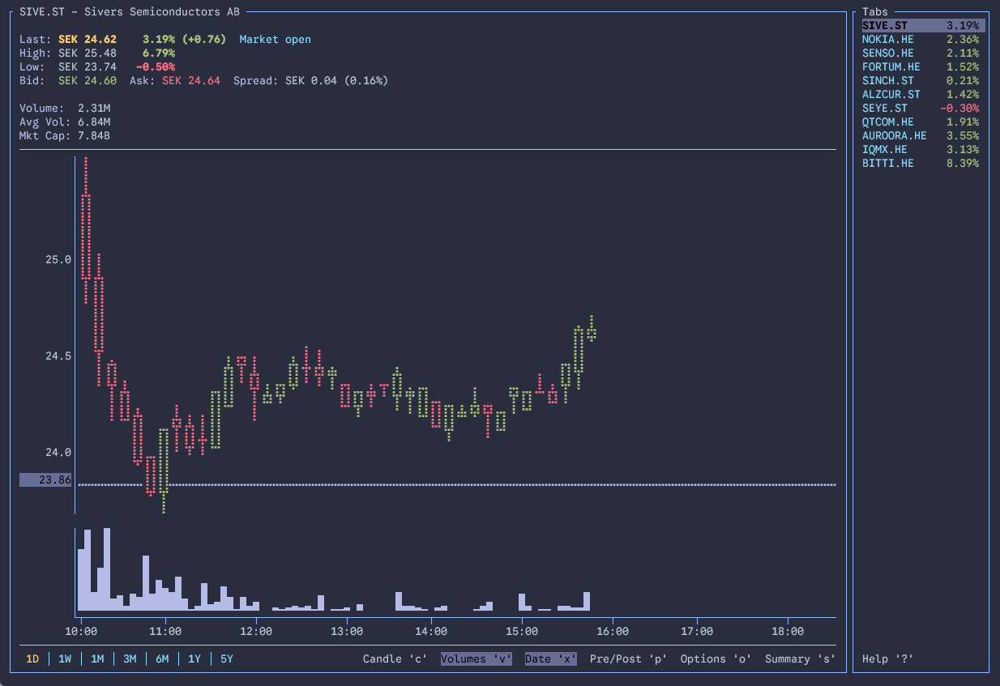

# tick-rs

Realtime ticker data in your terminal 📈 Built with Rust. Data sourced from Yahoo! Finance.

> [!NOTE]
> This is a fork of [tarkah/tickrs](https://github.com/tarkah/tickrs) that has diverged
> considerably from the original. It is not published to crates.io or any package manager.



## Installation

Clone the repository and build it:

```
git clone https://github.com/jtlehtinen/tickrs
cd tickrs
cargo build --release
```

The binary is at `target/release/tickrs`.

## Config File

On first run, tickrs writes a commented default config to `tickrs/config.yml` in your
platform's config directory:

- Linux: `~/.config/tickrs/config.yml`
- macOS: `~/Library/Application Support/tickrs/config.yml`
- Windows: `%APPDATA%\tickrs\config.yml`

It accepts the same options as the command line; run `tickrs --help` to list them.

## Acknowledgments
- [ratatui](https://github.com/ratatui/ratatui) - TUI library for Rust, and [fdehau](https://github.com/fdehau) / [tui-rs](https://github.com/fdehau/tui-rs) before it
- [cjbassi](https://github.com/cjbassi) / [ytop](https://github.com/cjbassi/ytop) - thanks for the inspiration!
